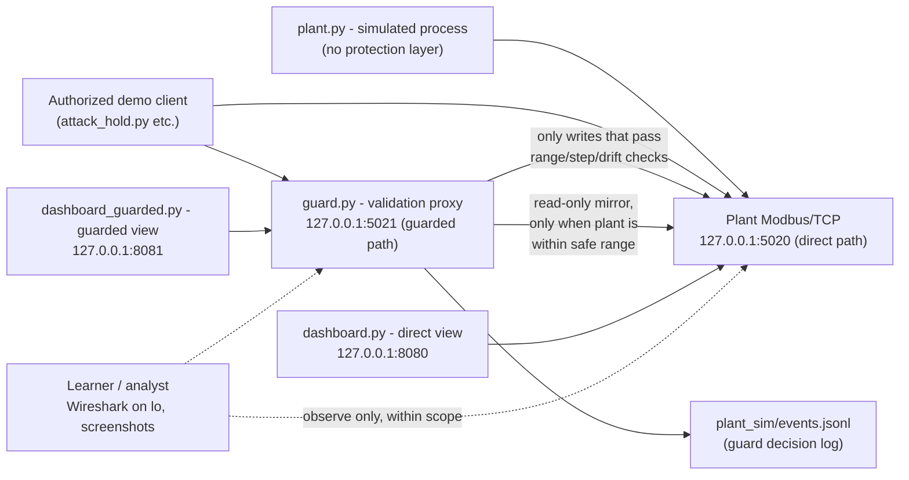

# Supplied Simulation Topology and Register Map

## 1. Source and scope

- Course source URL: https://github.com/icdfa/ACICP302ICS-Network-Security-and-Attacks
- Source commit used: `2a66f9bcf253eb3fe31c68ad52794cd535421da8`
- Canonical path: `labs/ot-security/student-lab-source/`
- Assigned Ubuntu VM/snapshot: Ubuntu 64-bit guest on VMware Workstation (hostname cyber-nate-VMware-Virtual-Platform); snapshot: LAB-START-1
- Authorized network scope: loopback (`127.0.0.1`) only

Loopback check performed per the Student Lab Guide, Section 4:

```
grep -R -nE '192\.168\.2\.139|0\.0\.0\.0' plant_sim || true    # expected: no output
grep -R -n '127\.0\.0\.1' plant_sim                             # expected: matches present
```

Result: the first command printed nothing and the second printed 13 matching lines, all `127.0.0.1`, in `plant.py`, `guard.py`, both dashboards and the six demonstration scripts. Full output: `evidence/01-preflight/preflight-loopback-check.txt`.

## 2. Annotated system topology

Reproduced and annotated from `docs/reference-architecture.md` in the course
source, with the four local service endpoints documented in the Student Lab
Guide added:



Data-flow notes (verified against source, not assumed):

- `plant.py` has **no validation of writes at all**. Its `ReactiveDataBlock.setValues()`
  records whatever is written directly into internal state, with no range or
  step check (`plant.py`, lines defining `ReactiveDataBlock.setValues`).
- `guard.py` sits in front of the plant as a **separate Modbus/TCP server on its
  own port (5021)**, not a wrapper around the plant's own port. A client must
  deliberately choose to connect to 5021 instead of 5020 to be protected; the
  guard cannot force traffic through itself (see limitation L-04 in
  `02-guard-analysis.md`).
- The guarded dashboard never talks to the plant directly; it only ever sees
  what the guard's own local register store holds (`dashboard_guarded.py` →
  `guard.py`'s Modbus interface).
- The guard independently maintains a background thread (`sync_safe_reads`)
  that mirrors the real plant's telemetry into its own exposed registers once
  per second, but **only when every one of temperature, pressure and flow is
  simultaneously inside its absolute safe range** (`guard.py`).

## 3. Supplied component inventory

| Component/source file | Supplied role | Local endpoint | Learner observation/source reference | Limitation or assumption |
|---|---|---|---|---|
| `plant_sim/plant.py` | Simulated process: generates temperature, pressure and flow telemetry on a 1-second tick; exposes them as Modbus/TCP holding registers with no write validation | `127.0.0.1:5020` | `REG_TEMP=0, REG_PRESSURE=1, REG_FLOW=2, REG_ALARM=3`; ranges defined as module-level constants `TEMP_RANGE/PRESSURE_RANGE/FLOW_RANGE` | No authentication; no write validation; any client that can reach the port can set any register to any value |
| `plant_sim/guard.py` | Write-through validation proxy: absolute-range, step and rolling-baseline drift checks on registers 0–2; forwards accepted writes to the real plant; logs rejected writes | `127.0.0.1:5021` | `GuardedContext._check()` and `GuardedContext.setValues()`; events appended to `events.jsonl` | Validates writes only (not reads); registers other than 0–2 bypass all checks; no anti-replay/freshness check; see `02-guard-analysis.md` for full table |
| `plant_sim/dashboard.py` | Unguarded HTTP dashboard reading directly from the plant | `http://127.0.0.1:8080` | Shows raw plant state, including any value an attacker on the direct path has forced in | No authentication on the dashboard itself |
| `plant_sim/dashboard_guarded.py` | HTTP dashboard reading from the guard's local store | `http://127.0.0.1:8081` | Shows only values the guard has validated or safely mirrored | Can show stale/frozen values if the real plant goes unsafe via the direct bypass path, since `sync_safe_reads` stops mirroring at that point |
| `plant_sim/attack_hold.py` | Demonstration: repeatedly writes an out-of-range pressure value (95.0 bar) for 8 seconds, reading back immediately each time | targets 5020 or 5021 via `sys.argv[1]` | `attack_value = 950` (tenths of a bar) | Demonstration script only; parameters must not be changed |
| `plant_sim/false_data_attack.py` | Demonstration: writes out-of-range temperature, pressure and flow together, 6 times, 1 second apart | targets 5020 or 5021 | Values `1100 / 550 / 2000` (tenths) | As above |
| `plant_sim/slow_drift_attack.py` | Demonstration: 12 incremental +1.0 bar pressure writes, 2 seconds apart | targets 5020 or 5021 | Tests rolling-baseline drift detection specifically | As above |
| `plant_sim/replay_attack.py` | Demonstration: writes the same (in-range) pressure value three times in quick succession | targets 5020 or 5021 | Tests for anti-replay/freshness protection | As above |
| `plant_sim/recon_scan.py` | Demonstration: reads registers 0–49 in five blocks of 10 | targets 5020 or 5021 | Tests whether reads are access-controlled | As above |
| `plant_sim/dos_attack.py` | Demonstration: 10 threads × 20 sequential reads (200 reads total) | targets 5020 or 5021 | Requires separate instructor approval before running | As above |

## 4. Verified Modbus/TCP data-point map

All registers are **Holding Registers** (Modbus function code `03` to read,
`06` to write a single register), accessed with `zero_mode=True`, so PLC-style
addressing and the raw Modbus address are identical (no `+1`/`40001` offset).
Scale and ranges are taken directly from the module-level constants in
`plant.py` and `guard.py`, which agree exactly between the two files.

| Data point | Register/address | Data type/scale | Unit | Source-defined safe range | Alarm/unsafe meaning | Source/evidence reference |
|---|---:|---|---|---|---|---|
| Temperature | 0 | UInt16, raw value is tenths of a degree C (divide by 10) | °C | 60.0–75.0 °C (raw 600–750) | No dedicated alarm register for temperature in this version; out-of-range values are simply outside the guard's accepted write range | `plant.py: TEMP_RANGE`, `guard.py: TEMP_RANGE` |
| Pressure | 1 | UInt16, tenths of a bar | bar | 30.0–40.0 bar (raw 300–400) | Register 3 (Alarm) is set to `1` by the plant's own tick whenever pressure ≥ 39.5 bar (raw ≥ 395), independent of the guard | `plant.py: PRESSURE_RANGE`, alarm condition in `simulate_normal_operation` |
| Flow | 2 | UInt16, tenths of Nm³/h | Nm³/h | 50.0–150.0 Nm³/h (raw 500–1500) | No dedicated alarm; out-of-range values are outside the guard's accepted write range | `plant.py: FLOW_RANGE`, `guard.py: FLOW_RANGE` |
| Alarm | 3 | UInt16 used as Bool (0/1) | - | n/a | `1` = high-pressure alarm active (pressure ≥ 39.5 bar); `0` = normal | `plant.py`, `simulate_normal_operation`. **Writes to this register bypass all guard validation** - see `02-guard-analysis.md`, L-03 |
| Registers 4–99 | 4–99 | UInt16 | - | n/a | Unused padding, initialized to 0, no defined process meaning | `plant.py: main()`, `initial_values + [0]*96` |

Observed normal baseline values at process start, per `plant.py` initial state
and the Student Lab Guide: temperature ≈ 67.0 °C, pressure ≈ 34.0 bar, flow ≈
90.0 Nm³/h, drifting by small random steps once per second
(`random.randint(-2,2)` / `(-3,3)` / `(-10,10)` respectively, each clamped to
its safe range).

Observed baselines (VM time; full table in `evidence/02-baseline/baseline-readings.md`):

| VM time | Dashboard | Temperature | Pressure | Flow |
|---|---|---:|---:|---:|
| 16:30 | Guarded | 68.0 C | 31.5 bar | 95.0 Nm3/h |
| 16:31:50 | Direct | 69.9 C | 30.9 bar | 97.9 Nm3/h |
| 16:39:07 | Direct | 72.4 C | 30.4 bar | 101.8 Nm3/h |
| 16:39 | Guarded | 71.1 C | 30.1 bar | 101.6 Nm3/h |

All values are inside the safe ranges and the plant alarm (register 3) was 0.

## 5. Normal data flow and baseline

The plant's `simulate_normal_operation` loop runs once per second, nudging
each of temperature, pressure and flow by a small random step and re-clamping
the result into its safe range, then writing the new values into its Modbus
holding registers and recomputing the alarm bit. The direct dashboard reads
these registers straight from the plant on port 5020. The guard's background
`sync_safe_reads` thread separately polls the same plant registers once per
second and copies them into the guard's own register store, but only when all
three values are simultaneously within their absolute safe ranges - so under
normal operation the guarded dashboard tracks the plant's natural drift with
at most a ~1 second lag, and the two dashboards should read almost identically.

The two dashboards tracked each other within normal drift (differences of about 1-2 units between pairs taken a minute apart). The guarded dashboard showed PROTECTED with an empty guard log. The plant drifts widely within range over tens of minutes: the captured response at 17:06:37 shows 66.9 C, 36.6 bar and 98.5 Nm3/h. Screenshots: `evidence/02-baseline/`.
